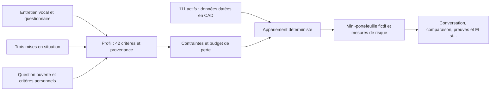

<p align="center"></p>

# AWSome — comprendre l'investisseur avant de composer le portefeuille

**Un système agentique qui écoute, met les préférences à l'épreuve et explique chaque proposition.**

Datathon PolyFinances 2026 · cas « AlphaForge AI » · Banque Nationale × AWS

Robert, 59 ans, prudent, veut placer 20 % de son portefeuille dans NVIDIA parce que tout le monde en parle. AWSome confronte cette demande à son profil : la perte de stress calculée passerait de **5,3 % à 18,4 %**, pour un budget de perte de **15 %**. Il explique le conflit, propose une part de **5 %**, et attend son accord avant de modifier le portefeuille fictif.

**C'est la promesse d'AWSome : comprendre une envie, en mesurer les conséquences et rendre la réponse vérifiable.**

[**Essayer l'application**](https://d29e3l5vv5fmjy.cloudfront.net) · [Projet Devpost](https://devpost.com/software/awsome) · [Une page](docs/one_pager.md) · [Documentation technique](docs/documentation_technique.md) · [Résultats reproductibles](docs/resultats_personas.md)

> **Simulation éducative.** Personas et montants fictifs ; aucun conseil financier personnalisé, aucune transaction réelle. Les mesures décrivent des données historiques et des hypothèses explicites, sans prédire les pertes futures.

## La démonstration en deux minutes

1. Ouvrir l'application et sélectionner **« Charger Robert »**. Les trois personas de l'énoncé sont disponibles avec des réponses simulées pour compléter leur profil.
2. Dans la synthèse, regarder le **budget de perte de 15 %** et la réponse qui le limite. Dans **« Hypothèses du profil »**, retrouver la provenance de chaque critère.
3. Choisir **« Découvrir mes propositions »**, puis **« Parler au conseiller »**. Demander **« J'aimerais 20 % de Nvidia »** : le système explique la tension et propose 5 %. Confirmer pour observer la nouvelle répartition.
4. Charger **Amira**, puis **Mateo**, et rechercher le même titre. Les réponses changent avec le profil, et les raisons restent consultables.

Pour découvrir le volet comportemental sans remplir de profil, choisir **« Découvrir le replay »** à l'accueil. Le parcours complet associe entretien vocal en français, questionnaire et trois mises en situation ; autoriser le microphone pour la voix.

## Le problème : une préférence ne suffit pas à définir un risque acceptable

Une personne peut accepter une baisse sur le papier et vouloir vendre lorsqu'elle la voit se produire. Elle peut aussi rechercher un titre médiatisé, exiger des exclusions ESG ou cumuler une exposition professionnelle et financière au même secteur.

AWSome relie **ce que la personne peut supporter, ce qu'elle déclare accepter, les choix qu'elle fait dans nos simulations et les caractéristiques observées des actifs**. L'utilisateur obtient un profil explicable, un verdict par actif et un mini-portefeuille fictif dont il peut explorer les limites.

## Trois investisseurs, un même titre, trois réponses expliquées

| Persona de l'énoncé | Besoin | Résultat sur les données actuelles | Ce que cela démontre |
|---|---|---|---|
| **Amira**, 26 ans, risque élevé, horizon de 15 ans et plus | Explorer la croissance, l'IA et les cryptoactifs | Budget de perte de **45 %** ; NVIDIA compatible, score **88/100**, plafonné à **10 %** | Un profil dynamique conserve des plafonds de concentration et de spéculation |
| **Mateo**, 41 ans, risque modéré, horizon de 8 à 12 ans | Faire respecter ses exigences ESG | **57 actifs exclus sur 111** par l'ensemble de ses contraintes ; NVIDIA exclu | Les exclusions priment sur les préférences et restent accompagnées de leurs preuves |
| **Robert**, 59 ans, risque faible à modéré, horizon de 3 à 5 ans | Résister à une concentration incompatible avec son profil | Budget de **15 %** ; NVIDIA à examiner, score **66/100**, plafonné à **5 %** | Un refus argumenté s'accompagne d'une alternative soumise à confirmation |

Ces résultats proviennent des [personas fictifs complétés](mvp_profil/personas/) et sont détaillés dans le [tableau reproductible](docs/resultats_personas.md). Les scores mesurent une compatibilité selon notre grille, jamais un rendement futur.

## Du dialogue à une proposition traçable



### Écouter, puis confronter le déclaré aux choix en simulation

L'entretien et le questionnaire renseignent **42 critères à valeurs fermées**. Un classificateur propose une lecture avec une citation exacte ; un critique la remet en question ; le code contrôle les valeurs et les citations. Une question ouverte permet d'ajouter des contraintes personnelles, comme une exposition à l'employeur ou une exclusion thématique.

Trois mises en situation complètent les réponses : **replay d'une baisse réelle de 2022**, choix entre des **fourchettes de résultats** et exploration de l'**effet de mode avec des titres masqués**. Elles observent des décisions dans une simulation, sans prétendre prédire le comportement avec de l'argent réel.

Le budget de perte retient la composante la plus prudente entre capacité financière, tolérance déclarée et tolérance observée dans ces exercices. La synthèse indique **quelle réponse limite le profil**.

### Appliquer les contraintes avant de classer les préférences

Le moteur évalue chaque actif : **compatible, à examiner, peu adapté, exclu ou données insuffisantes**. Il applique les exclusions, plafonds et seuils avant les préférences : un bon score ne rachète jamais une exclusion.

Le mini-portefeuille combine une poche de croissance et une poche amortissante. Le moteur vérifie notamment les concentrations, les expositions connues à travers les fonds et le rapport entre perte de stress et budget de perte. Une contrainte irréalisable est signalée ; la part non plaçable peut rester en encaisse avec une explication.

### Expliquer et permettre la contradiction

L'utilisateur recherche un actif, en compare deux, exprime une envie ou explore **« Et si… ? »**. Le système montre la règle qui fait la différence. Une modification d'horizon peut ne rien changer au budget : si le comportement observé reste limitant, AWSome l'explique.

Pour Robert, passer à 5 % de NVIDIA porte la perte de stress calculée de **5,3 % à 8,4 %** ; demander 20 % la porterait à **18,4 %** et dépasserait aussi son plafond par titre. Le système distingue l'évaluation d'une demande et son application, qui attend une confirmation.

## Les agents interprètent ; le code calcule et contrôle

| Composant | Rôle effectif |
|---|---|
| **Classificateur et Critique** — Claude Haiku 5.5, Amazon Bedrock | Extraire les critères, conserver les citations et contester les interprétations fragiles |
| **Découvreur et Chercheur** — Claude Haiku 5.5 avec outils | Traduire une demande personnelle en critères et chercher des liens documentés dans les données ou Wikipédia |
| **Conseiller** — Claude Sonnet 5.5 avec outils | Comprendre une demande, appeler les outils autorisés, préparer une proposition et gérer sa confirmation |
| **Explicateur** — Claude Sonnet 5.5 avec outils | Consulter contraintes et preuves pour expliquer un verdict déjà calculé |
| **Moteur déterministe** — Python | Calculer contraintes, scores, pondérations, mesures et verdicts ; vérifier les effets des outils et les sorties des agents |

Le code rejette une valeur hors liste, une citation absente du texte fourni ou une preuve qui ne figure pas dans la source lue. Pour la restitution financière, le modèle sélectionne des détails autorisés dans un catalogue : **verdicts, chiffres, avertissements et confirmations restent imposés par le code**. Une sortie hors contrat revient à un gabarit calculé. Cela borne la restitution ; cela ne garantit pas que l'interprétation initiale soit toujours correcte.

Une [expérience exploratoire de neuf portefeuilles construits par le modèle seul](docs/experience_modele_seul.md), antérieure aux derniers correctifs, a relevé trois omissions d'une contrainte d'exposition au secteur de l'emploi non rappelée explicitement au modèle. Ce petit échantillon motive notre séparation des responsabilités ; il ne constitue pas une évaluation générale des modèles.

## L'explicabilité se vérifie à l'écran et dans le dépôt

| Question de l'utilisateur | Preuve disponible |
|---|---|
| « Pourquoi ce profil ? » | Réponse, citation, provenance et confiance déclarée, avec les critères inconnus visibles |
| « Pourquoi cet actif ? » | Critères appliqués, verdict, score et références aux données datées |
| « Pourquoi cette limite ? » | Plafond et hypothèse écrite dans les fichiers de configuration |
| « Pourquoi ce risque ? » | Mesures sur les séries en CAD, période et composante de stress retenue |
| « Qu'est-ce qui changerait la réponse ? » | Recalcul dans « Et si… ? » et tests de sensibilité |
| « Qu'a fait l'agent ? » | Outils appelés, entrées, sorties et contrôles dans « Détails techniques » |

Les traces exposent les actions observables, sans afficher ni journaliser le raisonnement interne des modèles. Les copies persistantes minimisent les champs de texte libre ; les détails restent dans la session courante. Voir les [contrôles des frontières d'agents](docs/corrections_frontieres_agents.md) et leurs limites de validation.

## AWS : un service pour chaque besoin

| Besoin | Services et intégration |
|---|---|
| Interprétation et outils agentiques | **Amazon Bedrock**, profils d'inférence Haiku et Sonnet configurés dans le code |
| Dialogue vocal en français canadien | **Amazon Transcribe** en continu et **Amazon Polly**, voix Gabrielle |
| Application web et microphone en HTTPS | **Amazon EC2**, Streamlit et **Amazon CloudFront** |
| Traces des propositions | **Amazon DynamoDB** et journal applicatif, avec version du contenu et contrôles |
| Livraison de l'application | **Amazon S3**, **AWS Systems Manager**, GitHub Actions : tests, paquet vérifié, installation et restauration en cas d'échec |
| Accès temporaires | **IAM**, rôle de l'instance et fédération **GitHub OIDC** pour le déploiement |
| Suivi des dépenses | **AWS Budgets** et budget applicatif d'appels IA ; un budget AWS n'est pas un plafond de dépense |

**Amazon Bedrock Guardrails est provisionné, mais désactivé par défaut** : il bloquait également des refus légitimes. Les validations du code restent actives et ne sont pas présentées comme équivalentes à un Guardrail. Les limites de résidence, de rétention et de validation cloud figurent dans la [documentation technique](docs/documentation_technique.md).

## Des données enrichies, datées et comparables

**111 actifs : 31 fournis au départ et 80 ajoutés**, pour élargir les régions, classes d'actifs et secteurs pertinents aux préférences. La fenêtre de travail va du **12 novembre 2021 au 12 novembre 2026**, avec des historiques disponibles variables et une conversion en **dollars canadiens**.

Prix et fondamentaux : Yahoo Finance via yfinance ; change : Banque du Canada ; macro : ALFRED ; attention : Wikimedia Pageviews ; données de fonds : sources publiques, dont BlackRock. Les controverses sont documentées individuellement. Sources, droits d'usage, transformations et couverture : [documentation technique](docs/documentation_technique.md), [data_extended](data_extended/README.md) et [data_extra](data_extra/README.md).

Les seuils et pondérations sont des **hypothèses d'équipe**, consultables dans [config/](config/) et [hypotheses_profil.json](mvp_profil/hypotheses_profil.json). Les mesures historiques reposent notamment sur une hypothèse de rééquilibrage quotidien ; elles ne représentent pas un rendement réalisé net de frais.

## Installation locale

Python et pip sont nécessaires ; **Node.js** sert aux tests des composants JavaScript. Depuis la racine du dépôt :

```powershell
# Windows / PowerShell
py -m venv .venv
.\.venv\Scripts\python.exe -m pip install -r requirements.txt -r mvp_profil/requirements.txt
.\.venv\Scripts\python.exe -m streamlit run mvp_profil/app.py
```

```bash
# macOS / Linux
python3 -m venv .venv
.venv/bin/python -m pip install -r requirements.txt -r mvp_profil/requirements.txt
.venv/bin/python -m streamlit run mvp_profil/app.py
```

Les dépendances sont contraintes par [constraints.txt](mvp_profil/constraints.txt). **Les personas préchargés, la synthèse et le moteur de propositions sont utilisables sans modèle.** L'analyse de nouvelles réponses et les agents demandent un accès AWS autorisé. Le profil propose aussi une connexion Anthropic locale ; les agents de recommandation utilisent Bedrock et reviennent aux gabarits sans ce service. La voix demande les services AWS correspondants. Voir [.env.example](.env.example), sans y placer de secrets destinés au dépôt.

## Vérifier les résultats

```powershell
.\.venv\Scripts\python.exe scripts/lancer_tests.py --timeout 300
.\.venv\Scripts\python.exe mvp_profil/evaluer_classement.py --verifier
.\.venv\Scripts\python.exe scripts/tableau_personas.py
```

Sur macOS/Linux, remplacer le chemin de l'exécutable par `.venv/bin/python`. La dernière commande régénère `docs/resultats_personas.md`.

Les suites locales couvrent notamment les exclusions, les contraintes de portefeuille, la restitution, les confirmations, les frontières d'outils, la confidentialité et l'interface. Elles substituent les services cloud : **elles vérifient le code, pas la précision réelle de la voix ou des modèles**. `--verifier` valide la structure du corpus de **51 phrases et 88 couples phrase–critère**, sans mesurer une performance de classement. Le protocole réel figure dans [docs/fiabilite_questions.md](docs/fiabilite_questions.md).

## Ce que le prototype démontre et ce qui reste à valider

AWSome démontre un parcours intégré du profil à la proposition, des contraintes reproductibles et une explication reliée aux données. Le site publié fournit un point d'entrée ; les résultats présentés ici sont reproductibles sur le code du dépôt. La parité fonctionnelle de chaque version hébergée, la voix et la persistance doivent être vérifiées sur le service réel.

- **Risque :** cinq ans de données ne couvrent pas tous les régimes. La perte de stress retient le pire de la perte maximale historique, de 2022 et d'un choc de taux déclaré. Le scénario fictif de krach est affiché séparément et n'entre pas dans ce budget.
- **Profil :** les décisions en simulation enrichissent le déclaré sans prouver le comportement réel ; les confiances des agents ne sont pas calibrées et la précision de la chaîne vocale reste à mesurer.
- **Données :** controverses non exhaustives, couverture partielle des fonds et biais de sélection de l'univers. Une absence de controverse identifiée ne vaut pas certification ESG.
- **Construction :** heuristique explicable, sans promesse d'optimalité ni de surperformance. Les règles restent à confronter à des experts et à davantage de profils.

Prochaines étapes : conversations annotées pour mesurer la qualité, historiques et scénarios élargis, meilleure couverture des fonds et des exclusions.

## Se repérer dans le dépôt

| Chemin | Contenu |
|---|---|
| `mvp_profil/` | Application, entretien, profil, voix, simulations et tests |
| `mvp_profil/recommandation/` | Appariement, portefeuille, agents, conversation, preuves et écrans |
| `config/` | Critères des actifs, seuils et correspondances profil ↔ actifs |
| `data_extended/`, `data_extra/` | Données, indicateurs et sources |
| `Datathon2026/` | Jeu de départ des organisateurs |
| `scripts/`, `infra/`, `.github/workflows/` | Collecte, calcul, tests, paquet et infrastructure |
| `docs/` | Documentation technique, résultats, audits, une page et script vidéo |

Pour approfondir : [fonctionnement du profil](docs/fonctionnement_profil.md) · [infrastructure](docs/infrastructure_profil.md) · [script vidéo](docs/script_video.md) · [sécurité](SECURITY.md).
